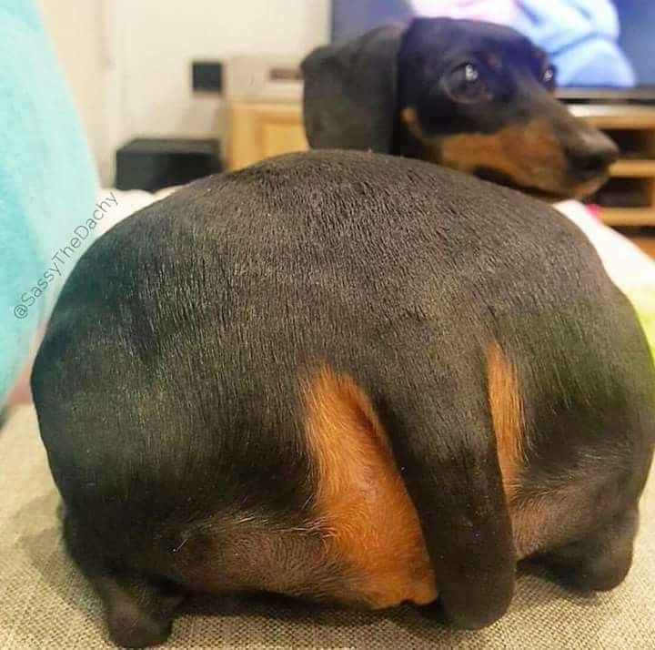

<div align="center">

# ✈️ LITO

**"Saudações Aeronáuticas!" — Lito Sousa**

Um drone controlado por gestos das mãos, feito em homenagem ao [Lito Sousa](https://www.youtube.com/@AvioesEMusicas)
e ao canal [Aviões e Músicas](https://www.youtube.com/@AvioesEMusicas). 🚁


| | |
|:---:|:---:|
| **Feito por alunos do 1ºDSB** | **Feira de ciências — Colégio Kennedy** |

</div>

---

## 1. 🙌 Sobre o Projeto

O **Lito** é um drone quadricóptero montado do zero usando um **ESP32-WROOM-32**, desenvolvido
por alunos do 1ºDSB para a **feira de ciências do Colégio Kennedy**, como homenagem ao
**Lito Sousa** e ao canal **[Aviões e Músicas](https://www.youtube.com/@AvioesEMusicas)**.

Para movê-lo, usamos um software em Python que, com [MediaPipe](https://github.com/google-ai-edge/mediapipe)
(HandLandmarker) e [OpenCV](https://github.com/opencv/opencv), lê as mãos pela câmera do
computador e classifica a direção do gesto: **cima, baixo, frente, trás, esquerda e direita**.
O comando confirmado é enviado por **Bluetooth Serial** ao ESP32.

> 🚨 **Nota honesta:** hoje o drone **ainda não voa** com os gestos — o ESP32 recebe a
> direção e dá **feedback por LED** (pino 2). O protocolo Bluetooth, porém, já está
> pronto para acionar os motores quando eletrônica de propulsão for implementada.

Neste guia listamos todos os componentes necessários para montar o seu próprio Lito,
o diagrama de ligação completo e todas as instruções de uso do software.

---

## 2. 👥 Equipe

| Nome   | GitHub |
|:------:|:------:|
| Kaike  | [@M100-ROSE](https://github.com/M100-ROSE) |
| Maria  | [@limasantosmaria2112-art](https://github.com/limasantosmaria2112-art) |
| Marcos | [@oliveiramarcos16-eng](https://github.com/oliveiramarcos16-eng) |

---

## 3. 📡 Como Funciona

O sistema funciona em uma cadeia de 3 etapas, da câmera até o ESP32:

```text
┌──────────────┐    ┌────────────────────────────────┐    ┌────────────────────┐
│ Câmera do PC │───▶│ Python (leitura_mão.py)        │───▶│ Bluetooth Serial   │
│   (webcam)   │    │ 1. DETECÇÃO: MediaPipe         │    │ (porta COM do PC)  │
└──────────────┘    │    HandLandmarker acha 2 mãos  │    └─────────┬──────────┘
                    │ 2. CLASSIFICAÇÃO: OpenCV       │              ▼
                    │    analisa dedos esticados     │    ┌────────────────────┐
                    │ 3. VOTAÇÃO: voto majoritário   │    │ ESP32-WROOM-32     │
                    │    confirma a direção          │    │ aciona o comando   │
                    │ 4. ENVIO: 1 letra na mudança   │    │ (hoje: LED pino 2; │
                    └────────────────────────────────┘    │ amanhã: motores)   │
                                                          └────────────────────┘
```

**Em detalhe:**

1. **Detecção** — o MediaPipe HandLandmarker (modo VIDEO) encontra até 2 mãos por frame
   e devolve 21 pontos de referência (landmarks) de cada uma.
2. **Classificação** — cada mão gera 5 sinalizadores (um por dedo: esticado ou dobrado)
   e a função `direcao()` decide qual gesto está sendo feito.
3. **Votação** — `direcao_estavel()` confirma a direção apenas por **voto majoritário**
   das últimas leituras, eliminando o "flicker" de frames mal classificados.
4. **Envio** — uma **única letra** é enviada ao ESP32 somente quando a direção confirmada
   **muda**, com um intervalo mínimo de 0,5 s entre envios.
   Sem Bluetooth conectado, o programa roda normal, apenas mostrando a câmera.

---

## 4. 🖐️ Gestos

Cada direção exige as **duas mãos** visíveis ao mesmo tempo. As imagens de referência
abaixo ficam em `leitura/direcoes/` e são exibidas na tela durante o uso:

| Direção | Como fazer | Referência |
|:-------:|:-----------|:----------:|
| **TRÁS** | As **duas mãos abertas** |  |
| **FRENTE** | As **duas mãos fechadas** |  |
| **ESQUERDA** | **Mão esquerda fechada** + **mão direita aberta** |  |
| **DIREITA** | **Mão direita fechada** + **mão esquerda aberta** |  |
| **CIMA** | Nas **duas mãos**: **polegar + indicador fechados** e **médio + anelar + mindinho esticados**; pulso esquerdo **mais alto** na tela |  |
| **BAIXO** | Mesmo gesto do cima, com o pulso direito **mais alto** na tela |  |

> 💡 No OpenCV, o eixo Y cresce **para baixo**, então o pulso "mais alto na tela"
> é aquele com o **menor** valor de Y (o pulso é o landmark 0).

---

## 5. 🔊 Contrato Bluetooth

O `leitura_mão.py` envia **um byte (uma letra)** ao ESP32 a cada mudança de direção confirmada:

| Letra | Direção  |
|:-----:|:---------|
| `T`   | TRÁS     |
| `F`   | FRENTE   |
| `E`   | ESQUERDA |
| `D`   | DIREITA  |
| `C`   | CIMA     |
| `B`   | BAIXO    |

**Extras de teste** (usados pelo `leitura/testebluetooth.py`):

| Letra | Ação |
|:-----:|:-----|
| `1`   | **Liga** o LED de feedback (pino 2) |
| `0`   | **Desliga** o LED de feedback (pino 2) |

**Configuração da conexão:**

| Parâmetro | Valor | Observação |
|:----------|:------|:-----------|
| Porta no PC | `COM4` | Ajustável na constante `PORTA_BLUETOOTH`, no topo do script |
| Baudrate | `9600` | Mesmo valor configurado no sketch do ESP32 |

> 💡 **Como descobrir a sua porta:** Gerenciador de Dispositivos → Portas
> (COM e LPT) → **"Standard Serial over Bluetooth link (COMx)"** → anote o COMx.

---

## 6. 🔧 Hardware

### 6.1 Lista de Componentes

| Nome | Quantidade |
|:-----|:----------:|
| ESP32D (WROOM-32) | 1 |
| Motor 8520 mini coreless **CW** | 2 |
| Motor 8520 mini coreless **CCW** | 2 |
| Sensor de distância a laser GY-530 VL53L0X | 5 |
| Transistor (MOSFET) IRLB4132 | 4 |
| Bateria LiPo 3,7 V 500 mAh | 1 |
| Kit 127 tubos termorretráteis | 1 |
| Placa de carregamento de bateria LiPo | 1 |
| Giroscópio e acelerômetro MPU6050 | 1 |
| Resistores metálicos 1/4 W | 8 |
| Header (cabeçalho) de pinos de furo redondo | 40 |
| Fio 24 AWG para negativo | 1 |
| Fio 24 AWG para positivo | 1 |
| Fio 30 AWG para positivo | 1 |
| Fio 30 AWG para negativo | 1 |
| Conector JST PH 2,0 mm 2 pinos macho/fêmea | 3 |
| Capacitor 100/220 µF | 1 |
| Capacitores 10/22 µF (para o regulador) | 2 |
| Diodos 1N4148 | 4 |
| Resistores 10 kΩ (pull-down do Gate) | 4 |

> ⚠️ **Observação:** os fios devem ser de **cores diferentes** para facilitar a
> identificação. Compre **1 conector JST PH 2,0 mm macho/fêmea extra** caso a sua
> bateria não venha com conector.

---

### 6.2 Sistema de Alimentação

#### Bateria LiPo 3,7 V 500 mAh

- **Função:** fonte principal de energia do drone.
- **Onde fica:** fixada no centro ou na parte de baixo do quadro (para manter o centro
  de gravidade baixo).
- **Ligação:** positivo (vermelho) e negativo (preto), através de conector JST PH 2,0 mm.

---

### 6.3 Controlador de Voo (Cérebro do Drone)

#### ESP32-WROOM-32

- **Função:** é o cérebro do drone. Processa os dados dos sensores, calcula a correção
  de estabilidade (PID) e gera os sinais PWM para os motores. Também permite controle
  via Bluetooth.
- **Onde fica:** no centro do quadro, bem fixo e nivelado.
- **Alimentação:** entre 3,5 V e 4,1 V, vindas da bateria.

---

### 6.4 Sensores

#### MPU6050 (Giroscópio + Acelerômetro)

- **Função:** mede a inclinação e a rotação do drone em todos os eixos. Essencial para
  o controle de estabilidade.
- **Onde fica:** bem no centro do quadro, abaixo do ESP32.

#### GY-530 VL53L0X (Sensor de Distância a Laser) — 5 unidades

- **Função:** mede a distância até o solo ou obstáculos com precisão (sensor ToF).
  Usado principalmente para controle de distância de obstáculos.
- **Onde ficam:** um apontando para **baixo** (distância do solo) e os outros 4, cada
  um apontando para esquerda, direita, frente e trás.

---

### 6.5 Sistema de Propulsão (Motores)

#### Motores Coreless 8520 (2 CW + 2 CCW)

- **Função:** geram a sustentação (empuxo) do drone.
- **Onde ficam:** um em cada braço do quadro.
- **Sentido de rotação recomendado:**

| Posição | Sentido |
|:--------|:-------:|
| Frente Direita (FR) | CCW |
| Trás Direita (TR) | CW |
| Trás Esquerda (TL) | CCW |
| Frente Esquerda (FL) | CW |

#### MOSFETs IRLB4132 (1 por motor)

- **Função:** funcionam como "chaves eletrônicas" que ligam e desligam os motores
  rapidamente (controle por PWM).
- **Onde ficam:** perto de cada motor ou em uma placa central.
- **Ligação de cada MOSFET:**
  - `Drain` → fio negativo do motor;
  - `Source` → GND;
  - `Gate` → resistor de 100~220 Ω → pino PWM do ESP32.
- **Sigla:** MOSFET = *Metal-Oxide-Semiconductor Field-Effect Transistor*.

#### Diodos 1N4148 (1 por motor)

- **Função:** protegem o circuito contra picos de tensão gerados pelos motores
  (back-EMF).
- **Onde ficam:** em paralelo com cada motor (cátodo no positivo do motor).

#### Resistores

- **100~220 Ω (4 unidades):** limitam a corrente no Gate do MOSFET.
- **10 kΩ (4 unidades):** pull-down — garantem que o motor fique desligado quando
  o ESP32 está desligado ou reiniciando.

---

### 6.6 Conexões de Sinais (Resumo)

| Função | Pino do ESP32 | Componente ligado |
|:-------|:-------------:|:------------------|
| I2C SDA | GPIO 21 | MPU6050 + 5x VL53L0X |
| I2C SCL | GPIO 22 | MPU6050 + 5x VL53L0X |
| Motor 1 (Frente Direita) | GPIO 25 | Gate do MOSFET 1 |
| Motor 2 (Trás Direita) | GPIO 26 | Gate do MOSFET 2 |
| Motor 3 (Trás Esquerda) | GPIO 33 | Gate do MOSFET 3 |
| Motor 4 (Frente Esquerda) | GPIO 32 | Gate do MOSFET 4 |

---

### 6.7 Fluxo de Energia (Resumo Visual)

```text
Bateria LiPo (3,7~4,2 V)
        │
        ├──→ Capacitor 100/220 µF
        │
        ├──→ Entrada do Regulador 3,3 V
        │         │
        │         ├──→ Capacitor 10/22 µF (entrada)
        │         │
        │         └──→ Saída 3,3 V
        │                   │
        │                   ├──→ Capacitor 10/22 µF (saída)
        │                   │
        │                   ├──→ ESP32 (3V3) + Capacitor 100 nF
        │                   ├──→ MPU6050 + Capacitor 100 nF
        │                   └──→ 5x VL53L0X + 5x Capacitor 100 nF
        │
        └──→ Motores (alimentação direta, sem passar pelo regulador)
```

---

### 6.8 ⚠️ Observações Finais de Segurança

- Sempre teste os motores **sem hélices** primeiro.
- Use tubo termorretrátil em **todas as soldas**.
- Mantenha os fios de potência (24 AWG) o mais **curtos** possível.
- O sensor VL53L0X principal deve apontar para **baixo** (controle de altura).
- **Calibre o MPU6050** com o drone em superfície plana antes do primeiro voo.

---

## 7. 📦 Modelo 3D

O desenho 3D do **chassi/corpo do drone** está na pasta `modelo/`:

| Arquivo | Formato | Uso |
|:--------|:--------|:----|
| `modelo/drone.glb` | GLB | Visualização interativa 3D (navegadores e visualizadores) |
| `modelo/drone.stl` | STL | Impressão 3D do chassi/corpo |
| `modelo/drone.zip` | ZIP | Pacote com os arquivos |

---

## 8. 🛠️ Como Executar

### 8.1 Requisitos

- **Python 3** instalado no computador;
- **Webcam** funcionando;
- PC **com Bluetooth** integrado ou adaptador externo;
- Placa **ESP32** com o sketch carregado.

### 8.2 Instalação

Instale as dependências Python:

```bash
pip install opencv-python mediapipe pyserial
```

### 8.3 Passo a passo

1. **Carregue o sketch `esp32`** (arquivo na raiz do repositório) na placa, via IDE
   Arduino. O dispositivo Bluetooth aparecerá com o nome **"LITO"**.
2. **Emparelhe o "LITO"** no Windows e descubra a porta COM (dica na seção
   [Contrato Bluetooth](#5--contrato-bluetooth)).
3. **Ajuste a porta**, se necessário: edite a constante `PORTA_BLUETOOTH` no topo de
   `leitura/leitura_mão.py` (padrão: `COM4`).
4. **Rode o programa de reconhecimento de gestos:**

```bash
python "leitura/leitura_mão.py"
```

> 💡 Para testar só o Bluetooth, rode `python leitura/testebluetooth.py` e envie `1`/`0`
> para acender/apagar o LED do ESP32.

### 8.4 Estrutura do Repositório

```text
Lito/
├── esp32                         # sketch Arduino (receptor Bluetooth, nome "LITO")
├── leitura/
│   ├── leitura_mão.py            # programa principal: câmera + gestos + envio serial
│   ├── testebluetooth.py         # teste manual da conexão Bluetooth ('1'/'0')
│   ├── hand_landmarker.task      # modelo do MediaPipe Hand Landmarker
│   └── direcoes/                 # imagens de referência dos gestos
│       ├── tras.jpg
│       ├── frente.jpg
│       ├── esquerda.jpg
│       ├── direita.jpg
│       ├── cima.jpg
│       └── baixo.jpg
├── modelo/
│   ├── drone.glb                 # modelo 3D (visualização)
│   ├── drone.stl                 # modelo 3D (impressão)
│   └── drone.zip                 # pacote do modelo
└── README.md                     # este arquivo
```

---

## 9. 🗺️ Roadmap

- [ ] **Rotação no próprio eixo** (sentido horário e anti-horário) — planejada;
- [ ] **Vídeos de funcionamento** — a anexar após a feira de ciências.

---

## 10. ❤️ Créditos e Licença

> **Feito com ❤ pelos alunos do 1ºDSB — em homenagem a Lito Sousa ✈️**

Inspirado e realizado como tributo ao canal
[**Aviões e Músicas**](https://www.youtube.com/@AvioesEMusicas) — *"Saudações Aeronáuticas!"* 🚁
